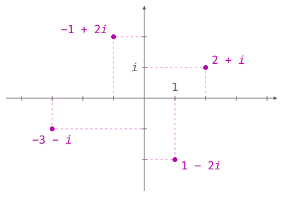
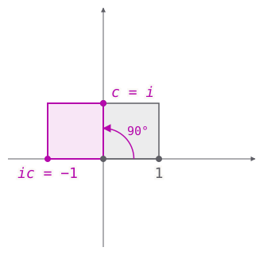
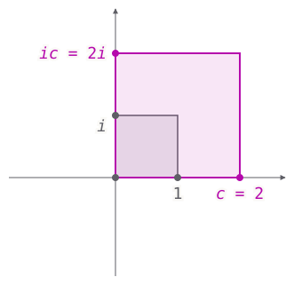
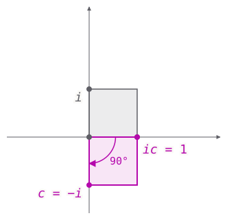
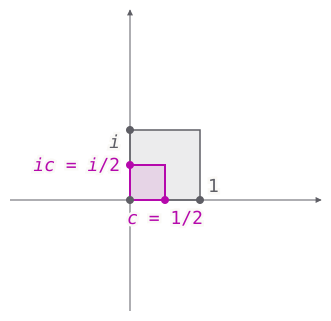
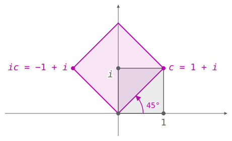

Mi hermana está cursando su primera asignatura de análisis complejo. Ella odia el análisis, y la verdad es que no es difícil odiarlo. Es un coñazo. Todo está lleno de números irracionales, derivadas, integrales, fórmulas absurdas que memorizar y que cuesta entender. Todo es mucho más fácil en álgebra, donde los objetos son tangibles. Pero el análisis complejo es diferente. 

No me acuerdo de cómo ni de por qué, pero mientras yo cursaba la asignatura de análisis complejo, me leí el mejor libro de matemáticas que he leído nunca, _Visual Complex Analysis_, de Tristan Needham. Me gustó tanto que hizo que la asignatura que más odiaba se convirtiera en mi asignatura favorita, y desde entonces, siempre pienso que odio el análisis real, pero adoro el análisis complejo. Hoy me gustaría intentar transmitirle ese amor a mi hermana.

Quiero empezar analizando la relación entre los números complejos y el plano. Un número complejo es un número $z = x + iy$ donde $x \in \mathbb{R}$ es la parte real de $z$ y $y \in \mathbb{R}$, la parte imaginaria. Podemos pensar en un número complejo $z$ como en una tupla $\langle x,y \rangle \in \mathbb{R}^2$ y dibujarlo en un plano cartesiano con la parte real en el eje X y la parte imaginaria en el eje Y. 

<figure>
  
  <figcaption>Algunos números complejos en el plano.</figcaption>
</figure>

La esencia del análisis complejo, y lo que lo diferencia del análisis vectorial, aparece en la multiplicación. Multiplicar un número complejo $z = x + iy$ por $i$ da $iz = -y + ix$, y convierte el punto $\langle x, y \rangle$ en $\langle -y, x \rangle$. Es decir, multiplicar por $i$ rota el plano. Por otro lado, multiplicar $z$ por un número real positivo, como $2$, da $2z$, y convierte el punto $\langle x, y \rangle$ en $\langle 2x, 2y \rangle$. Es decir, multiplicar por $2$ estira el plano.

Para entender esta idea mejor, podemos dibujar qué le pasa al plano. Basta con fijarnos en el cuadrado de vértices $0$, $1$, $1 + i$ e $i$, en gris, y ver a dónde lo lleva la multiplicación, en rosa.

<figure>
  
  <figcaption>Multiplicar por c = i gira el plano 90°.</figcaption>
</figure>
<figure>
  
  <figcaption>Multiplicar por c = 2 estira el plano.</figcaption>
</figure>

Ahora podemos probar a multiplicar por otros números y ver qué pasa. Si multiplicamos $z$ por $-i$, el plano rota hacia el otro lado, en sentido horario. Y si multiplicamos $z$ por $1/2$, el plano se contrae hacia el centro.

<figure>
  
  <figcaption>Multiplicar por c = −i gira el plano −90°.</figcaption>
</figure>
<figure>
  
  <figcaption>Multiplicar por c = 1/2 contrae el plano.</figcaption>
</figure>

¿Pero qué pasa si multiplicamos $z$ por un número complejo $c$ cualquiera? Para verlo, podemos empezar probando con los números complejos más sencillos, $1$ e $i$. El $1$ va a $c$, e $i$ va a $ic$, que es $c$ girado un cuarto de vuelta. Así que el cuadrado que forman $1$ e $i$ se convierte en otro cuadrado, girado y estirado. Y como $c\,z = c\,(x + iy) = x \cdot c + y \cdot ic$, el resto del plano les sigue. Así, multiplicar por $c$ gira el plano el ángulo de $c$, el que forma con el eje real, y lo estira $\lvert c \rvert$ veces, donde $\lvert c \rvert$ es la distancia de $c$ a $0$.

Por ejemplo, $1 + i$ forma un ángulo de 45° y tiene módulo $\sqrt{2}$, así que multiplicar por $1 + i$ gira el plano 45° y lo estira $\sqrt{2}$ veces.

<figure>
  
  <figcaption>Multiplicar por c = 1 + i lleva el cuadrado gris al rosa.</figcaption>
</figure>

Y por eso, multiplicar números complejos es girar y estirar (o comprimir).